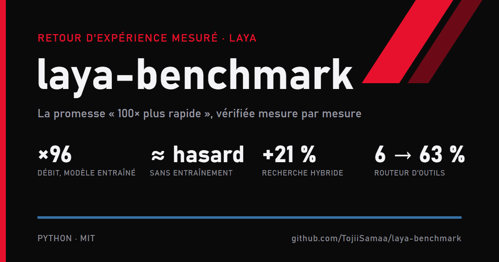

laya-benchmark est un retour d'expérience mesuré sur Laya, un petit modèle de décision open source présenté comme « 100 fois plus rapide que le cloud ». Sans entraînement, il fait à peine mieux que le hasard (0,36 contre 0,32). Entraîné sur des données réelles avec la méthode « prof vers élève », il atteint un débit 96 fois supérieur au modèle local qu'il imite. Ce qui a le plus rapporté : la recherche hybride locale (+21 %) et le routeur d'outils (de 6 % à 63 %). Licence MIT.
